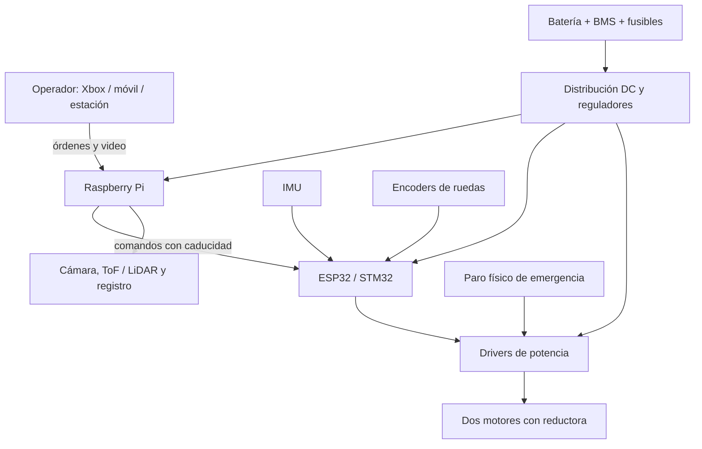
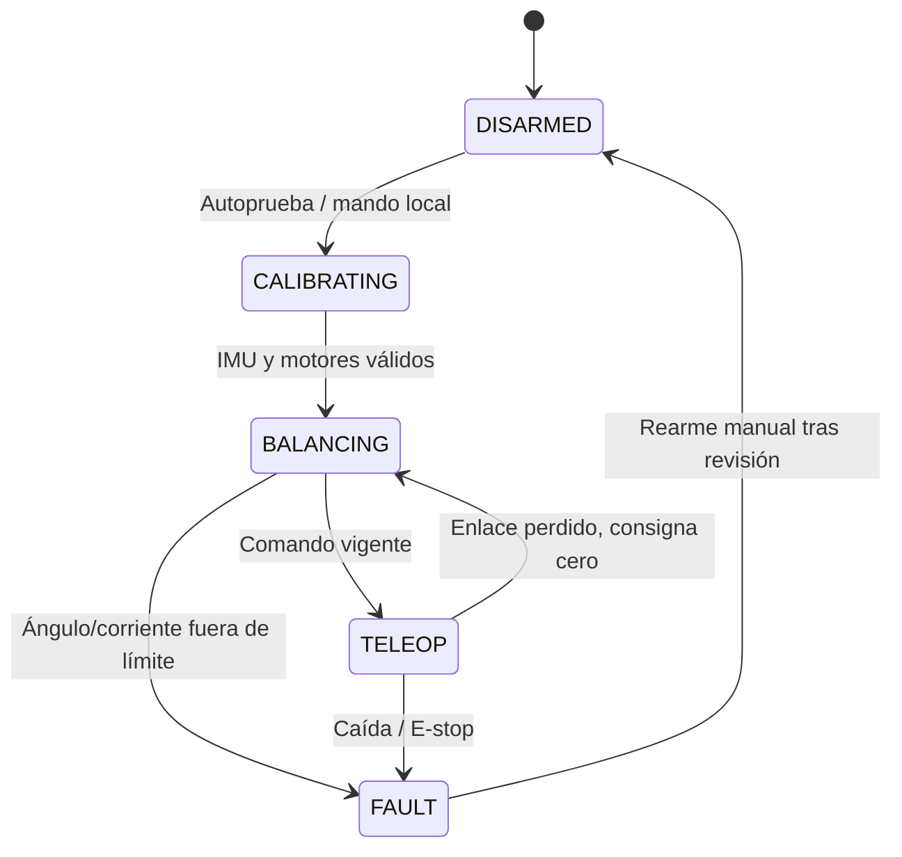

# BLACKMAMBA SENTINEL B-01

**Robot autoequilibrado de exploración y asistencia en campo, con Raspberry Pi**  
**Estado:** diseño conceptual v0.1 — no construido ni probado físicamente  
**División:** BlackMamba Corp · Robotics & Embedded Systems

> Plataforma modular de dos ruedas, basada en un péndulo invertido, diseñada para mantenerse vertical mientras transporta una Raspberry Pi y sensores intercambiables. Su funcionalidad «táctica» se refiere a reconocimiento del entorno, navegación, monitoreo y teleoperación en actividades civiles, industriales y de rescate; no incorpora armamento ni identificación de objetivos humanos.

## 1. Objetivo

Construir un vehículo pequeño y reparable que:

- Se mantenga en equilibrio dinámico sobre dos ruedas motrices.
- Transporte una Raspberry Pi 4 o 5 sin delegarle los lazos críticos de estabilidad.
- Se controle localmente o desde teléfono/computadora/control Xbox.
- Emita video, orientación, estado de batería y telemetría.
- Permita añadir cámaras, sensores ToF/LiDAR, iluminación y sensores ambientales.
- Siga operando el equilibrio de manera independiente si Linux se reinicia o se pierde la conexión.

## 2. Arquitectura



### Contratos de los nodos

| Nodo | Función | Entradas | Salidas | Respaldo o fallo seguro |
|---|---|---|---|---|
| Raspberry Pi | Video, teleoperación, registro, navegación | Cámara, sensores, comandos del operador | Referencias de velocidad y giro | Si deja de responder, el MCU mantiene la estabilidad local y rechaza comandos vencidos |
| ESP32/STM32 | Equilibrio en tiempo real | IMU, encoders, setpoints, batería | PWM/dirección, diagnóstico | Watchdog, límites de corriente/ángulo, apagado de potencia al caer |
| Drivers | Convertir comandos en corriente de motor | PWM, dirección, habilitación | Corriente a motores | Pin de enable y protección de corriente/temperatura |
| Energía | Alimentación estable y protegida | Paquete de batería | Riel de motores y riel lógico | BMS, fusibles, corte por bajo voltaje |
| Operador | Supervisión y parada | Telemetría y video | Comandos limitados + parada | Botón de hombre muerto; parada local independiente del enlace |

**Decisión clave:** Linux no controla directamente el PWM de equilibrio: el ESP32/STM32 mantiene un bucle determinista aunque la Raspberry Pi se ocupe de video o IA.

## 3. Componentes propuestos (BOM inicial)

| Cantidad | Componente | Requisito de selección |
|---:|---|---|
| 1 | Raspberry Pi 4/5 | SBC principal; refrigeración y almacenamiento adecuados |
| 1 | ESP32 o STM32 | Temporizadores/PWM, interrupciones y watchdog |
| 1 | IMU de 6 ejes | Acelerómetro + giroscopio; baja latencia, fijación rígida |
| 2 | Motor DC con reductora y encoder | Par, relación de engranes, corriente de arranque y velocidad calculados según masa final |
| 2 | Rueda de 100–130 mm de diámetro | Neumático con agarre y concentricidad comprobada |
| 1 o 2 | Driver puente H compatible | Corriente continua y pico superiores a los valores medidos del motor, con margen térmico |
| 1 | Batería recargable con BMS | Química y tensión seleccionadas según motor y autonomía; cargador compatible |
| 1 | Regulador aislado por función para SBC | Para Pi 5, alimentación USB-C apropiada, nominal 5 V/5 A y margen de picos |
| 1 | Regulador lógico | Tensión estable para MCU/sensores y tierras de referencia diseñadas |
| 1 | Fusible y desconexión general | Dimensionados después del presupuesto de corriente |
| 1 | Paro de emergencia cableado | Debe inhibir físicamente la etapa de motores |
| 1 | Chasis con soportes de caída | Protección de electrónica y puntos de anclaje de batería/cámara |
| Opcional | Cámara + ToF/LiDAR + LED | Percepción, distancia frontal, iluminación |

**Importante:** el circuito de baterías no debe alimentar motores a través de la Raspberry Pi. No se define un número de fusible, pinout ni modelo exacto de driver hasta conocer los motores, la batería y la masa real.

## 4. Mecánica conceptual

- **Configuración:** dos ruedas coaxiales, motorizadas de forma independiente; sin tercera rueda tocando el piso durante el equilibrio.
- **Ancho exterior objetivo:** 220–320 mm (a verificar con ruedas y espacio para batería).
- **Altura objetivo:** 260–380 mm.
- **Centro de masa:** por encima del eje, ajustable mediante ranuras; evitar accesorios pesados montados en lo alto.
- **Chasis:** placas de aluminio, policarbonato o piezas impresas reforzadas; priorizar rigidez alrededor de la IMU.
- **Protección:** defensas o patines laterales que soporten caídas sin golpear conectores.
- **Mantenimiento:** acceso rápido a batería, fusibles, interruptor y USB de diagnóstico.

Estas cotas son **hipótesis de partida**, no planos de fabricación. Los motores se dimensionarán con masa, centro de masa, radio de rueda, pendiente y aceleración objetivo.

## 5. Control de equilibrio

El cuerpo se aproxima como un **péndulo invertido sobre ruedas**. La IMU estima inclinación `theta` y velocidad angular `theta_dot`; los encoders proporcionan velocidad/desplazamiento. El controlador modula el par de los motores para corregir la inclinación.

### Lazos propuestos

1. **Fusión IMU**: 200–500 Hz, filtro complementario o Kalman, con calibración de offset.
2. **Lazo interno de inclinación**: 200–500 Hz, PID/PD inicialmente, LQR como experimento posterior.
3. **Lazo externo de velocidad**: 20–50 Hz; genera pequeña referencia de inclinación para avanzar o frenar.
4. **Control de giro**: mezcla diferencial limitada de par entre rueda izquierda y derecha.
5. **Supervisor**: watchdog, estado de batería, corriente, temperatura y validación de comandos.

Una ley PD de arranque —con signos definidos por pruebas del sentido físico del motor— es:

```text
u = Kp * (theta_ref - theta) - Kd * theta_dot

motor_left  = saturate(u - yaw_cmd)
motor_right = saturate(u + yaw_cmd)
```

**No aplicar ganancias tomadas de internet directamente.** Primero verificar signos, torque, límites de PWM y respuesta con el robot sujeto en una base de pruebas. La integral y el controlador de velocidad se añaden una vez que el equilibrio básico sea estable.

### Estados de operación



El paro de emergencia corta la potencia de los motores; por definición un vehículo de dos ruedas sin apoyos caerá, por eso debe tener protecciones mecánicas y zona de pruebas libre. El enlace perdido no debe mandar PWM antiguo: primero se lleva la consigna a cero y se mantiene el equilibrio local mientras sea seguro.

## 6. Funciones tácticas de campo (no armadas)

| Módulo | Función | Versión objetivo |
|---|---|---|
| Reconocimiento visual | Video local, visión nocturna por cámara apropiada, fotografías georreferenciables cuando haya fuente de posición confiable | v0.2 |
| Exploración remota | Control Xbox, joystick web, parada de hombre muerto y límite de velocidad | v0.1 |
| Percepción de obstáculos | Distancia frontal ToF, luego LiDAR 2D; detener avance ante obstáculo | v0.2 |
| Inspección industrial | Temperatura, gases adecuados al riesgo, medición ambiental | v0.3 |
| Operación sin internet | Wi‑Fi local/AP, registros en microSD/SSD, cola de eventos | v0.2 |
| Mapeo | Odometría, IMU, SLAM opcional; distinguir desplazamiento estimado de ubicación real | v0.3 |
| Misión supervisada | Puntos de inspección con confirmación del operador y retorno controlado | v0.4 |
| Reporte técnico | Bitácora de batería, velocidad, inclinación, pérdida de enlace y caídas | v0.1 |

**Límite funcional:** no se incluyen armas, mecanismos de daño, persecución de personas ni selección de blancos. Su uso táctico es observación y apoyo seguro en campo.

## 7. Comunicación y API mínima

Transporte inicial: UART con CRC entre Raspberry Pi y MCU; Wi‑Fi local con autenticación entre operador y Raspberry Pi. Todos los comandos llevan número de secuencia, tiempo de emisión y expiración.

Ejemplo lógico (JSON legible para documentación; protocolo binario compacto opcional):

```json
{
  "type": "motion.command",
  "seq": 154,
  "timestamp_ms": 172000,
  "ttl_ms": 200,
  "linear_mps": 0.15,
  "yaw_radps": 0.20,
  "deadman": true
}
```

Respuesta:

```json
{
  "type": "robot.telemetry",
  "seq": 154,
  "state": "BALANCING",
  "pitch_rad": -0.03,
  "pitch_rate_radps": 0.11,
  "battery_v": 11.6,
  "faults": []
}
```

Los números anteriores son **ejemplos sintéticos**, no mediciones. El firmware rechaza paquetes vencidos, malformados, duplicados o por encima de límites configurados. El comando `disarm` debe existir fuera de la interfaz web y el paro físico tiene prioridad absoluta.

## 8. Estructura propuesta del repositorio

```text
blackmamba-sentinel/
├── README.md
├── docs/
│   ├── architecture.md
│   ├── electrical.md
│   ├── mechanical.md
│   └── test-plan.md
├── firmware/
│   ├── balance-controller/
│   ├── drivers/
│   └── tests/
├── raspberry/
│   ├── telemetry/
│   ├── teleop/
│   ├── perception/
│   └── tests/
├── shared/
│   └── protocol/
├── simulation/
│   └── inverted-pendulum/
└── hardware/
    ├── cad/
    ├── bom/
    └── wiring/
```

No se presupone que estas carpetas existan todavía.

## 9. Criterios medibles de aceptación

| Gate | Prueba | Criterio de entrada / aprobación |
|---|---|---|
| G0 — Simulación | Modelo de péndulo, sensores con ruido y saturación de actuador | Recuperar perturbaciones definidas y registrar error angular/tiempo sin saturación sostenida |
| G1 — Electrónica | Rieles, corriente de arranque, E-stop, watchdog, CRC | Motores se deshabilitan con E-stop y fallos inyectados; sin caída del riel SBC |
| G2 — Banco sujetado | Verificar sentido de giro, estimación de `theta`, latencia y jitter | Signos correctos; latencia y máximos documentados; sin oscilación incontrolada |
| G3 — Balance libre | Piso plano, área despejada, protectores | Mantener equilibrio 60 s, 5 repeticiones; registrar ángulo, corriente y tasa de caídas |
| G4 — Movimiento | Avanzar, frenar, retroceder, girar | Sin pérdida de equilibrio en secuencia repetible y límites de velocidad definidos |
| G5 — Fallos | Desconectar red, matar proceso Pi, bajar batería simulada, E-stop | Sin continuación de órdenes caducadas y con transición reproducible a estado seguro |
| G6 — Módulos | Cámara/ToF y grabación | Video y telemetría sin degradar el periodo del MCU |

Los tiempos/frecuencias son **objetivos a validar**, no resultados obtenidos. Anotar masa real, carga útil, temperatura, autonomía, precisión y gasto energético por ensayo.

## 10. Hoja de ruta

- [ ] **v0.1**: simulador, protocolo de telemetría, firmware de equilibrio, teleoperación y E-stop.
- [ ] **v0.2**: chasis físico, cámara, sensor frontal y registro local.
- [ ] **v0.3**: odometría, mapeo opcional y carga útil ambiental.
- [ ] **v0.4**: misiones supervisadas de inspección, reportes automáticos y banco de pruebas A/B PID vs. LQR.

## 11. Riesgos técnicos abiertos

1. **Par insuficiente / driver subdimensionado:** medir masa y requerimientos dinámicos antes de comprar motores.
2. **Ruido eléctrico en IMU:** separar rutas de potencia, filtrar y comprobar vibración/calibración.
3. **Caídas y daños físicos:** diseñar topes de protección y pruebas con soporte.
4. **Alimentación Pi 5:** garantizar una fuente regulada adecuada; Raspberry Pi recomienda una fuente USB-C de 5 V/5 A para operación con periféricos.
5. **Jitter de Linux:** no cerrar el lazo de equilibrio en la Raspberry Pi.
6. **Autonomía sobreestimada:** medir consumo en reposo, equilibrio, teleoperación y video.
7. **Superficies irregulares:** limitar el alcance inicial a pisos firmes, planos y secos; no prometer operación todo terreno.

## 12. Referencias técnicas oficiales

- [Raspberry Pi 5: alimentación y hardware](https://www.raspberrypi.com/documentation/computers/raspberry-pi.html)
- [Espressif: MCPWM para control de motores](https://docs.espressif.com/projects/esp-idf/en/latest/esp32/api-reference/peripherals/mcpwm/index.html)
- [ST: control móvil y sensores](https://www.st.com/en/applications/robotics/mobile-controls-and-sensing.html)

## Estado del proyecto

**Diseñado:** concepto de arquitectura, módulos, interfaces y gates de prueba.  
**Pendiente:** ingeniería de detalle, selección y adquisición de componentes, CAD, cableado, firmware, simulación, pruebas de banco y validación física.  
**Implementado / probado / desplegado:** no, todavía.

---

*BlackMamba Corp — SENTINEL B-01 · Documento base de ingeniería, revisión 0.1.*
